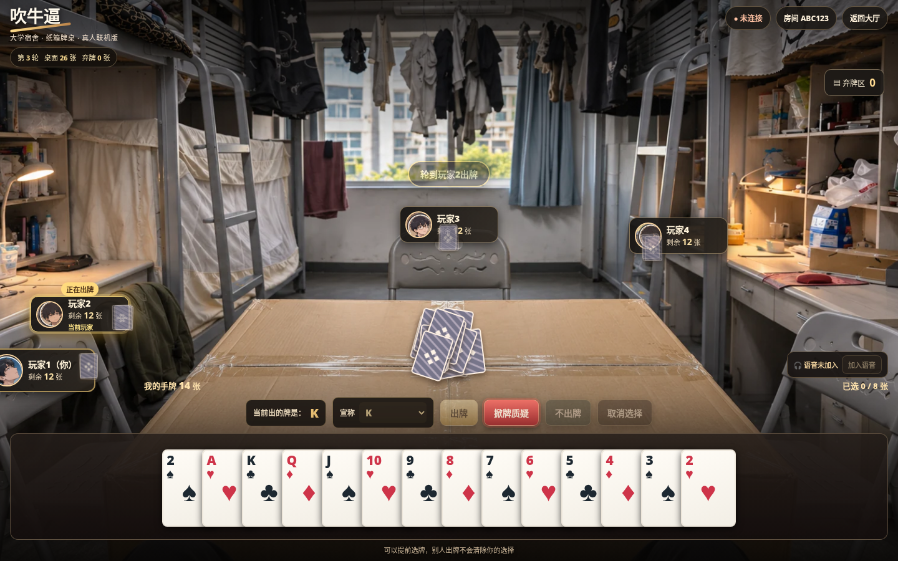
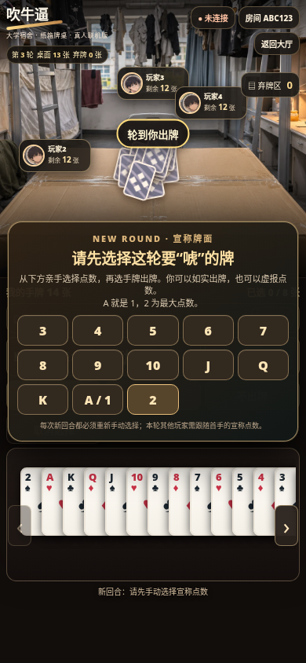
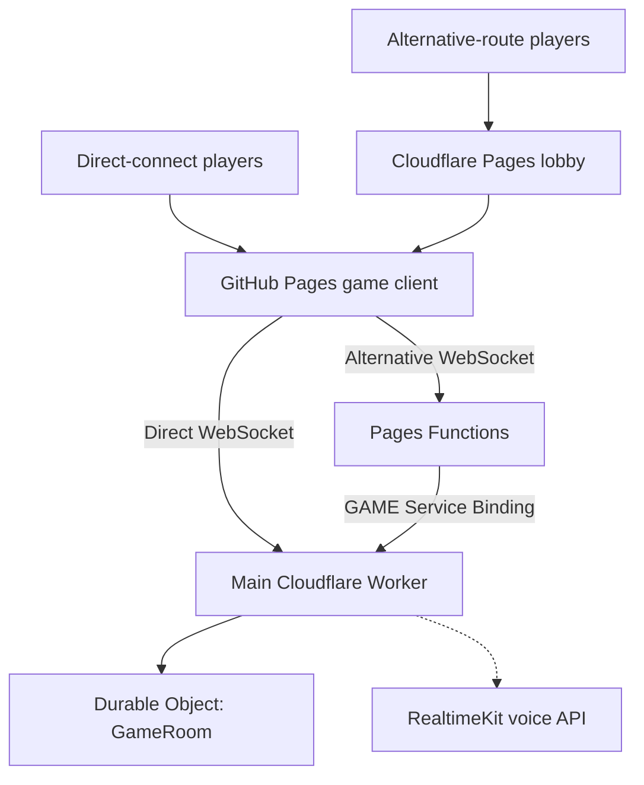

# 🃏 Chuiniubi (吹牛逼) · V7.9

<p align="center"><strong>A dorm-room-themed, real-player, online bluffing card game</strong></p>

<p align="center"><a href="./README.md"><kbd>🇨🇳 简体中文</kbd></a> &nbsp; <a href="./README.en.md"><kbd>🇬🇧 English (current)</kbd></a></p>

<p align="center"><a href="https://kilemoran.github.io/chuiniubi/"><strong>🎮 Play Now</strong></a> · <a href="https://chuiniubi-relay.pages.dev/">🌏 Alternative Entry</a> · <a href="./CHANGELOG.en.md">📜 Changelog</a> · <a href="./DEPLOY_GUIDE.md">🛠️ Deployment Guide (Chinese)</a></p>

> **Documentation version:** V7.9, reflecting the client and `server/game.js` on 11 November 2026. The server is authoritative for cards, challenges, random events and results. Some historical UI and `/health` version labels have not been synchronized with the gameplay version; consult the actual code and deployments.

## Contents

- [Introduction](#introduction)
- [Getting started and joining a room](#getting-started-and-joining-a-room)
- [Complete game rules](#complete-game-rules)
- [V7.9 random events](#v79-random-events)
- [Interface and controls](#interface-and-controls)
- [International connectivity and architecture](#international-connectivity-and-architecture)
- [Real-time voice](#real-time-voice)
- [Reconnection and room lifecycle](#reconnection-and-room-lifecycle)
- [Repository structure and technology](#repository-structure-and-technology)
- [Development and deployment](#development-and-deployment)
- [Frequently asked questions](#frequently-asked-questions)
- [Version history](#version-history)

## Introduction

**Chuiniubi** is a browser-based multiplayer bluffing card game set around a makeshift cardboard table in a university dormitory. Players take turns placing cards face down while announcing a quantity and rank. A declaration may be truthful or a bluff. Any other eligible player can challenge the most recent play; the losing side of the challenge picks up **all cards accumulated on the table during that round**. The first player to legally empty their hand wins.

The interface features a dormitory backdrop, seats around the cardboard table, dealing and playing animations, challenge callouts, staged reveals and card-collection effects. It supports desktop, mobile portrait and mobile landscape layouts. **All multiplayer opponents are humans. The one-player mode is strictly for testing, not an AI mode.**

**Highlights:** rooms for 1–6 players, wild jokers, up to 12 cards per play, live selected-card counter, four low-probability easter eggs, two-stage card reveals, Cloudflare RealtimeKit voice, reconnection, and an alternative WebSocket route for friends on different networks.

### Play and source links

| Link | Purpose |
| --- | --- |
| [Main game](https://kilemoran.github.io/chuiniubi/) | Create and join rooms, play the game |
| [Alternative entry lobby](https://chuiniubi-relay.pages.dev/) | Alternative WebSocket route and connection checks |
| [Main server health](https://my-chuiniubi-room.syc050609.workers.dev/health) | Check the main Worker over HTTP |
| [Alternative health](https://chuiniubi-relay.pages.dev/health) | Check the Pages-to-Worker binding |
| [Main repository](https://github.com/KileMoran/chuiniubi) | Frontend, rules, Worker, tests, documentation |
| [Alternative-entry repository](https://github.com/KileMoran/chuiniubi-relay) | Cloudflare Pages Functions relay |

> The alternative `pages.dev` domain is **not guaranteed to work on every network in mainland China**. A successful HTTP health check, a functioning WebSocket connection, and working RealtimeKit voice are three separate requirements.

## Getting started and joining a room

### Host: create a room

1. Visit the [main site](https://kilemoran.github.io/chuiniubi/) and enter a nickname.
2. Choose a **1–6 player** room capacity. Use 2–6 for an ordinary multiplayer match; one-player mode is a development/testing tool.
3. Create a room and copy its **six-character alphanumeric room code**.
4. Share the code with friends. The room must reach its configured player count, with everyone online, before the host can start.
5. The server randomly selects the first player to lead.

### Friends: join a room

1. Open the main game site or start from the [alternative lobby](https://chuiniubi-relay.pages.dev/).
2. Enter a nickname and the same six-character code **before the match starts**.
3. New identities cannot join a match already in progress. Returning players may recover their existing seat and hand using the token saved by the same browser while the room still exists.
4. Advanced users can change the WebSocket address in the homepage's server settings. Ensure both routes ultimately reach the **same main Worker**.

## Complete game rules

### Decks, room capacity, and dealing

| Players | Decks | Total cards | Total jokers | Initial cards per player |
| --- | ---: | ---: | ---: | --- |
| 1 (testing) | 1 | 54 | 2 | 54 |
| 2 | 1 | 54 | 2 | 27 |
| 3 | 2 | 108 | 4 | 36 |
| 4 | 2 | 108 | 4 | 27 |
| 5 | 2 | 108 | 4 | 21–22 |
| 6 | 2 | 108 | 4 | 18 |

Each deck contains 52 standard cards, one big joker (大王) and one small joker (小王). The server shuffles and distributes as evenly as possible. The older “four decks / 208 cards for three players” rule is **obsolete in V7.9**.

### Turns, declarations, and playing cards

- The server randomly chooses the opening player at the start of each match.
- The first play of each **new round** must explicitly declare a rank from `3 4 5 6 7 8 9 10 J Q K A 2`.
- All subsequent plays in the same round must declare the **same rank**, although the actual face-down cards can differ: bluffing is allowed.
- Play **1–12 cards at once**. The interface displays `Selected X/12` (localized UI currently uses Chinese), and the server independently checks quantity, card ownership, duplicate selections and declared rank.
- You may select cards from your own hand in advance, but the server accepts your play only on your turn.
- Normally, other players see the announced rank and number of cards, not the hidden card faces.

### 🃏 Wild jokers

Both joker ranks count as **the declared rank**, so they cannot by themselves make a play false. However, a joker does **not** excuse an unrelated ordinary card.

For a declaration of **K**:

| Actual cards played | Verdict |
| --- | --- |
| `K + K` | Truthful |
| `K + big joker` | Truthful |
| `big joker + small joker` | Truthful |
| `K + small joker + 7` | **Bluff** — the ordinary 7 does not match K |

### ⏱️ Two-second protection is NOT a challenge deadline

**The approximately two-second delay prevents the next player from instantly playing. It does not end the challenge window.**

- After someone plays, the next player must wait about **two seconds** before taking their turn.
- Other eligible players may challenge the most recent play during that pause.
- They may **still challenge after those two seconds** provided the next player has **not yet played a new hand**.
- Once a newer hand is played, that latest hand becomes the challenge target. You cannot challenge your own hand, and a player blocked by the phone event cannot challenge.

### Challenges, reveals, and collecting cards

1. A player challenges the latest hand, triggering the “假的！！！” (“FAKE!!!”) feedback.
2. The server first reveals the **challenged last play**, checking whether any non-joker card differs from the declared rank.
3. It then reveals **all earlier face-down cards from the same round**, with paging on the tabletop when necessary.
4. **Successful challenge / caught bluff:** the player who lied takes all cards on the table; the **challenger** leads the next round.
5. **Unsuccessful challenge / honest play:** the **challenger** takes all cards on the table; the player whose hand was challenged leads the next round.
6. Once collection ends, a new round starts with a **fresh rank selection**.

The server normally discloses only your own hand. Other players' hidden card faces are not sent until a valid reveal stage or specific event makes them public.

### Passing, discarding, and winning

- On your turn you may pass instead of playing.
- When every other player declines to continue the round, the entire table pile is **discarded**, and the last player to play leads the new round.
- A player wins after legally playing their last cards without subsequently being caught bluffing in the permitted resolution.
- **Solo testing:** each played hand is automatically cleared, a new round begins, and play continues until the 54-card hand is empty; random events are disabled.

## V7.9 random events

After each **successful card play**, the authoritative server attempts to trigger **one** event with a **3% overall probability**. This is **not 3% per event**. At most one event occurs for a given play, and each event type can occur **once per match**. If an event is selected but cannot execute, it is skipped without consuming its match allowance. Events are always disabled in solo testing.

| Event | Effect | Eligibility |
| --- | --- | --- |
| 🧑‍🏫 The teacher enters the dorm | A random eligible player drops **one card** | Target must have **at least 10 cards** |
| 🗑️ A bin gets knocked over | A random eligible player discards **one card** amid the chaos | Target must have **at least 10 cards** |
| 🃏 A card accidentally flips face up | **One random card from the latest hand** becomes visible to all early | Latest played hand must exist |
| 📱 An important phone message | A random player cannot act for the next **four player-action turns**; their turn is skipped automatically if reached | Target must still hold cards |

Discarded event cards are moved into the **discard pile**, preserving the total number of cards. The phone counter advances with **everyone's actions**, not four personal turns of the affected player. The blocked player cannot play, select cards or challenge. Events are server-controlled, not client-selectable.

Because the probability is deliberately low and eligibility is conditional, a match with no events is normal.

## Interface and controls

- Dorm room, cardboard table, avatars, nicknames, seating, and active-player emphasis.
- Sorted cards with horizontal scrolling, selection preview and real-time `X/12` selected counter.
- Current round, declared rank, pile size, discard count and recent actions.
- Card-play animation, randomly scattered face-down piles, two-stage tabletop reveals, page navigation and collection effects.
- Dedicated joker styling and special visuals for an unexpectedly exposed card.
- Desktop, mobile portrait and mobile landscape layouts; appearance also depends on device dimensions and browser scaling.

### Screenshots

| Desktop table | Mobile interface |
| --- | --- |
|  |  |

> Images in `preview/` are development snapshots; some predate V7.9. The live site is the source of truth for current visuals.

## International connectivity and architecture

Both entry routes use **the same authoritative Worker and room state**. The relay is not an alternative, independent game server.



**Responsibilities:**

- `index.html` draws the interface and acts as a WebSocket/voice client.
- `server/worker.js` handles `/health`, `/ws`, membership, Durable Object access, reconnection, voice tickets and cleanup.
- `server/game.js` is the authoritative rule engine for shuffling, playing, challenges, turns, events and public state.
- The separate `chuiniubi-relay` Pages Functions forward `/ws` and `/health` using the private **`GAME → my-chuiniubi-room`** Service Binding.
- RealtimeKit media does **not** travel through the normal game WebSocket relay; voice connectivity must be validated separately.

```text
Game website:        https://kilemoran.github.io/chuiniubi/
Direct WebSocket:    wss://my-chuiniubi-room.syc050609.workers.dev/ws
Alternative WS:      wss://chuiniubi-relay.pages.dev/ws
Main /health:        https://my-chuiniubi-room.syc050609.workers.dev/health
Alternative /health: https://chuiniubi-relay.pages.dev/health
```

### Playing together across countries

1. The host creates a room on the main site and shares its **six-character code**.
2. Players on networks with direct access use the default route. Friends needing the alternative route visit the [Pages lobby](https://chuiniubi-relay.pages.dev/).
3. The alternative lobby opens the same GitHub Pages client with `server=wss://chuiniubi-relay.pages.dev`, changing only its WebSocket endpoint.
4. Everyone joins the same room code and arrives at the same Worker/Durable Object. Start once all seats are filled.
5. After testing WebSocket gameplay, test the microphones and audio connection separately.

**Accessibility is not guaranteed on every network**, especially across international borders; the lobby, HTTP health check, WebSocket and RealtimeKit can have different outcomes.

## Real-time voice

Voice is provided by **Cloudflare RealtimeKit**, with a join-voice action, microphone controls, sound/mute controls, per-friend volume settings and speaking-state UI. The client requests a meeting ticket via the game Worker before connecting to RealtimeKit.

The main Worker uses these **environment-variable names** (values must remain private):

| Name | Role |
| --- | --- |
| `CF_RTK_ACCOUNT_ID` | Cloudflare account |
| `CF_RTK_APP_ID` | RealtimeKit application |
| `CF_RTK_API_TOKEN` | Private API token — store as a Worker Secret |
| `CF_RTK_PRESET` | Participant preset for the voice meeting |

Do **not** commit voice secrets, player identity tokens or full WebSocket URLs containing a token to GitHub. When troubleshooting voice, check browser microphone permission, meeting join status, per-friend volume, Worker configuration and actual network connectivity independently.

## Reconnection and room lifecycle

- The browser stores recent room details, nickname, server address and an identity token locally, enabling refresh or short-outage recovery of an existing seat and hand.
- When **all players have been disconnected for two consecutive hours**, a Durable Objects Alarm removes the room and associated persistent state.
- A room with at least one online player is not closed merely for lack of gameplay activity.
- Expired rooms return players to the lobby and must be recreated. New identities cannot enter an ongoing match.
- Clearing site data or changing devices/browsers can lose the previous token, preventing recovery of the same seat.

## Repository structure and technology

```text
chuiniubi/
├── index.html                  # Frontend UI and voice controls
├── server/
│   ├── game.js                 # Authoritative rules and random events
│   └── worker.js               # Worker, WebSocket, rooms, voice
├── tests/
│   ├── game.test.js            # Core gameplay
│   ├── joker-rules.test.js     # Wild jokers, 12-card limit
│   ├── random-events.test.js   # All four events
│   ├── reveal-stages.test.js   # Reveal phases and secrecy
│   └── room-lifecycle.test.js  # Reconnection and expiration
├── preview/                    # Historical UI screenshots
├── wrangler.toml               # Worker / Durable Objects settings
├── package.json               # Local scripts
├── README.md                  # Chinese README
├── README.en.md               # English README (this file)
├── CHANGELOG.md               # Chinese full changelog
├── CHANGELOG.en.md            # English changelog
└── DEPLOY_GUIDE.md            # Deployment guide (Chinese)
```

| Layer | Technology |
| --- | --- |
| Frontend | HTML, CSS, vanilla JavaScript |
| Static hosting | GitHub Pages |
| Multiplayer transport | WebSocket |
| Game server | Cloudflare Workers |
| Room state/timers | Durable Objects and Alarms |
| Alternative route | Cloudflare Pages Functions / Service Binding |
| Voice | Cloudflare RealtimeKit |
| Tests | Node.js built-in `node:test` |

The old root-level `game.js` and patch-upgrade scripts have been removed. The current authoritative rules module is **`server/game.js`**.

## Development and deployment

| Changed files | Required action |
| --- | --- |
| `README*.md`, `CHANGELOG*.md`, `tests/` | Commit to GitHub; **no game Worker redeployment needed** |
| `index.html` | Let GitHub Pages publish, then refresh the browser |
| `server/game.js` or `server/worker.js` | Commit **and independently verify a Cloudflare Worker deployment** |
| Separate `chuiniubi-relay` repository | Publish through its own Cloudflare Pages project |

**Players do not need to install anything or run terminal commands.** Developers with local Node.js and Wrangler may optionally use:

```bash
npm install
npm test
npm run dev
npm run deploy
```

These are **local development commands**, not instructions to run npm inside the GitHub website. Preserve `keep_vars = true`, the `ROOMS → GameRoom` Durable Object binding, and all `CF_RTK_*` settings when deploying. See the [deployment guide (Chinese)](./DEPLOY_GUIDE.md) for the GitHub/Cloudflare upload workflow.

The repository tests cover core gameplay, joker behavior, the 12-card limit, random events, reveal secrecy and room lifecycle. **Automated rule tests do not replace cross-device/browser, real WebSocket, or real voice-call testing.**

## Frequently asked questions

<details><summary><strong>Why no longer use four decks for a three-player game?</strong></summary>

That was an earlier rule. V7.9 uses **54 cards for one or two players, 108 cards for three to six**, including jokers in every deck.
</details>

<details><summary><strong>Why can I challenge after two seconds?</strong></summary>

This is intended. The two seconds only prevent the next player from playing instantly. You may still challenge the most recent hand until a newer hand is played.
</details>

<details><summary><strong>Why did no random event appear?</strong></summary>

The server attempts one event with **3% overall probability per successful play**; eligibility checks, already-used events, solo testing and an emptied final hand can prevent an event from actually occurring.
</details>

<details><summary><strong>The alternative lobby opens but the room does not connect — why?</strong></summary>

Check the lobby itself, `/health`, WebSocket connectivity, and then actual room entry. New players cannot enter an ongoing game. `pages.dev` accessibility is network-dependent.
</details>

<details><summary><strong>Why can I play, but voice does not work?</strong></summary>

Gameplay WebSockets and RealtimeKit media use separate connections. Verify microphone permission, successful meeting join, friend volume, the Worker's RealtimeKit configuration, and real two-device connectivity.
</details>

<details><summary><strong>Why did my old room disappear?</strong></summary>

A room is cleaned up after all players stay offline for two hours. Clearing browser data may also destroy the token required to recover the old seat.
</details>

<details><summary><strong>Why does /health still report gameplay v7.7.3?</strong></summary>

This is a **hard-coded legacy string** in `server/worker.js`. The separate `version: 1.1-voice` is an interface/voice identifier. Neither value alone establishes which gameplay rules are deployed; check the Worker deployment and test a newly created room.
</details>

## Version history

| Version | Date | Highlights |
| --- | --- | --- |
| **V7.9** | 10–11 Nov 2026 | Four dorm easter eggs, 3% overall chance, once per type, disabled in solo |
| **V7.8** | 10 Nov 2026 | Wild jokers, 12-card maximum, live selection count, 54/108-card decks |
| **V7.7.3** | 7 Nov 2026 | Two-stage reveals directly on the tabletop, paginated layouts |
| **V7.7.1** | 7 Nov 2026 | Two-hour all-offline room expiration and recovery behavior |
| **V7.4** | Earlier version | RealtimeKit voice, individual volume, mobile landscape |
| **V7.0** | Earlier version | Real-player multiplayer with server-authoritative game state |

Full development history V1–V7.9: **[Chinese changelog](./CHANGELOG.md)** · **[English changelog](./CHANGELOG.en.md)**.

---

Maintainer: **KyleMoran**. When reporting a bug, please include device/browser, room size, direct/alternative route, and reproducible steps. **Never expose identity tokens or voice API secrets.**

<p align="center"><a href="./README.md"><kbd>🇨🇳 简体中文</kbd></a> &nbsp; <a href="./README.en.md"><kbd>🇬🇧 English</kbd></a> &nbsp; <a href="#-chuiniubi-吹牛逼--v79">⬆ Back to top</a></p>
