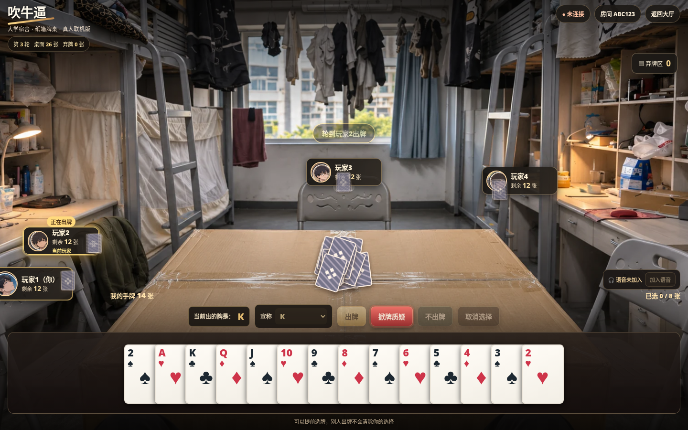
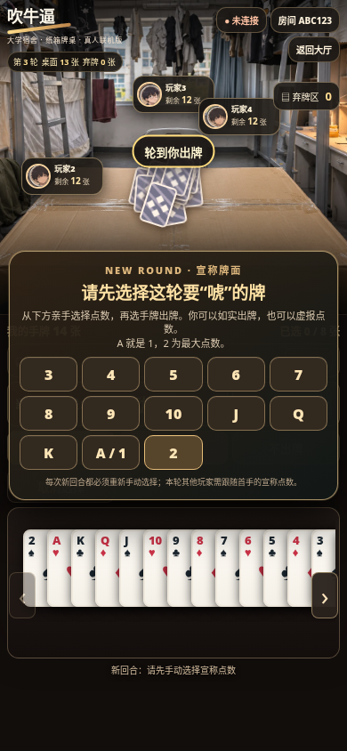
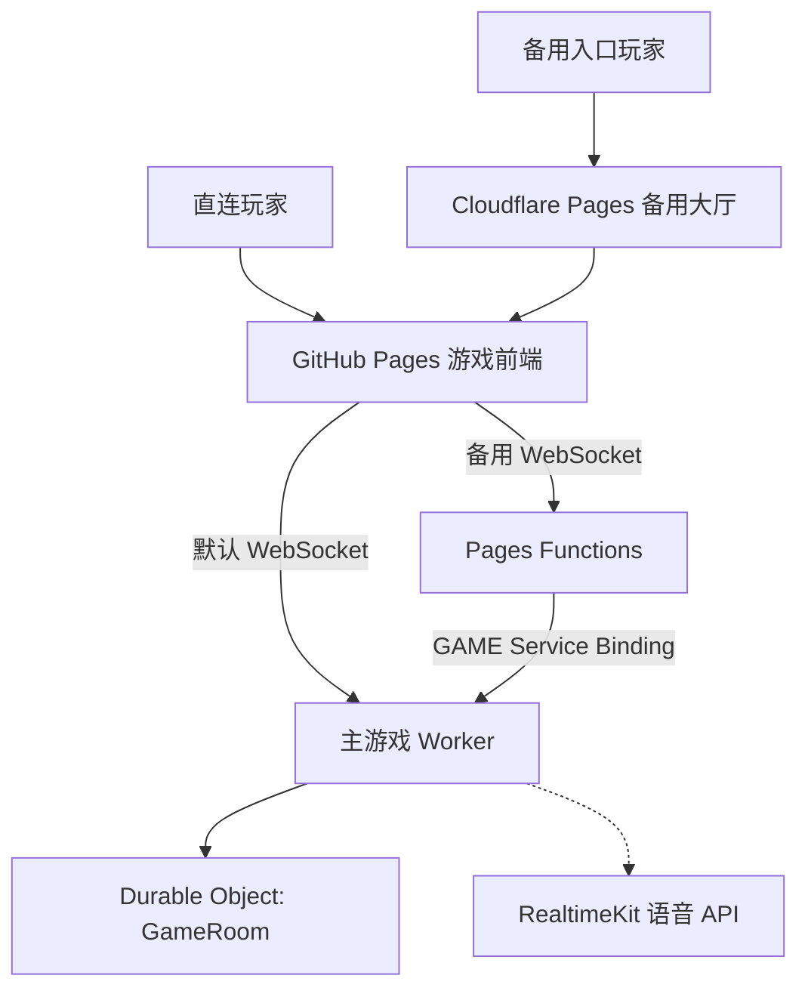

# 🃏 吹牛逼 · Chuiniubi V7.9

<p align="center"><strong>大学宿舍里的真人联机吹牛扑克 | Dorm-room multiplayer bluffing card game</strong></p>

<p align="center"><a href="./README.md"><kbd>🇨🇳 简体中文（当前）</kbd></a> &nbsp; <a href="./README.en.md"><kbd>🇬🇧 English</kbd></a></p>

<p align="center"><a href="https://kilemoran.github.io/chuiniubi/"><strong>🎮 开始游戏</strong></a> · <a href="https://chuiniubi-relay.pages.dev/">🌏 备用入口</a> · <a href="./CHANGELOG.md">📜 更新日志</a> · <a href="./DEPLOY_GUIDE.md">🛠️ 部署指南</a></p>

> **版本说明：** 本说明对应截至 2026-11-11 的 V7.9 客户端和 `server/game.js` 规则。游戏由服务器决定发牌、质疑、随机事件及胜负。部分历史 UI 更新日志或 Worker 健康检查标记尚保留旧版本文字，不能取代实际源码。

## 📖 目录

- [项目简介](#项目简介)
- [立即游玩与房间操作](#立即游玩与房间操作)
- [完整游戏规则](#完整游戏规则)
- [V7.9 随机彩蛋](#v79-随机彩蛋)
- [界面与操作](#界面与操作)
- [跨国联机与网络架构](#跨国联机与网络架构)
- [实时语音](#实时语音)
- [断线恢复与房间生命周期](#断线恢复与房间生命周期)
- [项目架构与目录](#项目架构与目录)
- [开发测试与部署](#开发测试与部署)
- [常见问题](#常见问题)
- [更新历史](#更新历史)

## 项目简介

《吹牛逼》是一款以大学宿舍为舞台的**浏览器真人联机吹牛扑克游戏**。玩家围坐在纸箱牌桌旁，轮流把牌扣到桌面上，宣称“几张某个点数”。你可以如实出牌，也可以虚报；其他玩家能够质疑最新一手。质疑失败的一方要收走整轮桌面牌。先合法打完手牌的人获胜。

游戏采用宿舍“上床下桌”、纸箱牌桌、围坐座位的视觉风格，有出牌、质疑喊话、翻牌、收牌的界面反馈；支持电脑、手机竖屏和横屏。**当前正式模式只有真人玩家；1 人模式用于测试，不含 AI 对手。**

**核心能力**：1–6 人房间、大小王万能癞子、每手最多 12 张、实时选牌计数、四种低概率彩蛋、两阶段翻牌、RealtimeKit 语音、断线重连及跨国备用 WebSocket 接入。

### 游戏与代码入口

| 地址 | 作用 |
| --- | --- |
| [正式游戏主站](https://kilemoran.github.io/chuiniubi/) | 创建房间、加入房间与正式游戏 |
| [备用联机大厅](https://chuiniubi-relay.pages.dev/) | 备用 WebSocket 路线、连接测试、进入同一个游戏 |
| [主服务器健康检查](https://my-chuiniubi-room.syc050609.workers.dev/health) | 检查游戏 Worker HTTP 状态 |
| [备用入口健康检查](https://chuiniubi-relay.pages.dev/health) | 检查 Pages → Worker 服务绑定 |
| [主仓库](https://github.com/KileMoran/chuiniubi) | 前端、游戏规则、Worker、测试与文档 |
| [备用入口仓库](https://github.com/KileMoran/chuiniubi-relay) | Cloudflare Pages Functions 中转 |

> **网络说明**：备用域名不能保证在中国大陆所有网络都可访问；HTTP `/health` 成功、WebSocket 成功及 RealtimeKit 语音成功是三项不同检查。

## 立即游玩与房间操作

### 创建房间（房主）

1. 打开 [游戏主站](https://kilemoran.github.io/chuiniubi/)，输入昵称。
2. 选择房间上限 **1–6 人**；正常真人对局建议 2–6 人。
3. 点击创建房间，获取一个 **6 位字母/数字房间号**。
4. 将房间号发给朋友。**人数到齐且全员在线**后，由房主开始游戏。
5. 系统随机抽选首出者，进入第一轮。

### 加入房间（朋友）

1. 在主站输入昵称和六位房间号，或先通过[备用大厅](https://chuiniubi-relay.pages.dev/)进入。
2. 必须在**开局前**以新玩家身份加入。游戏中途不能添加新座位。
3. 若自己只是刷新或短暂断线，同一浏览器可以使用此前保存的玩家身份恢复已有座位、手牌。
4. 若在高级设置中手动修改服务器 WebSocket 地址，要确保大家实际接入的是**同一个主 Worker**。

## 完整游戏规则

### 牌组、人数与发牌

| 房间人数 | 副数 | 总牌数 | 大小王总数 | 开局每人手牌 |
| --- | ---: | ---: | ---: | --- |
| 1 人（测试） | 1 | 54 | 2 | 54 |
| 2 人 | 1 | 54 | 2 | 27 |
| 3 人 | 2 | 108 | 4 | 36 |
| 4 人 | 2 | 108 | 4 | 27 |
| 5 人 | 2 | 108 | 4 | 21–22 |
| 6 人 | 2 | 108 | 4 | 18 |

每副扑克牌为 52 张普通牌 + 1 大王 + 1 小王；服务器洗牌并尽可能平均发牌。旧版本的“3 人 4 副 208 张”已不适用于 V7.9。

### 轮次、宣称点数与出牌

- 每局系统随机抽取第一位出牌者；每一轮首手玩家必须主动选择本轮宣称点数：`3 4 5 6 7 8 9 10 J Q K A 2`。
- 随后的玩家只能宣称**相同点数**，但真实打出的牌可以与宣称不同——撒谎是游戏的一部分。
- 每次可选 **1–12 张**，选牌区和出牌按钮实时显示 `已选 X/12`；服务器也会校验数量、归属和宣称点数。不能重复选同一张牌。
- 可以在等待别人的行动时预先选择自己的手牌；真正出牌必须轮到本人。
- 正常状态下牌面朝下放到桌面，公开的是宣称数量与点数，而不是真实牌面。

### 🃏 大小王是万能癞子

大小王均可视为当前宣称点数，**本身不算假牌**，但不会使同手的错误普通牌变成真牌。

例如宣称 **K** 时：

| 实际出牌 | 判定 |
| --- | --- |
| `K + K` | 真 |
| `K + 大王` | 真 |
| `大王 + 小王` | 真 |
| `K + 小王 + 7` | **假**，因为普通 7 不等于 K |

### ⏱️ 两秒保护间隔 ≠ 质疑时限

**两秒只用于防止下一位玩家立刻出牌，不是“超过两秒不能质疑”。**

- 玩家打出一手后，下一玩家须等待约 **2 秒**才可以行动。
- 其他符合条件的玩家可以在这两秒内质疑，也可以在两秒结束后、下一玩家**尚未打出新牌**时继续质疑最新一手。
- 一旦有人打出新牌，质疑目标就是新的一手；不能质疑自己；手机彩蛋禁用期间不能质疑。

### 质疑、揭牌与收牌

1. 有人点击质疑，界面出现“假的！！！”等反馈。
2. 服务端先揭示**最近被质疑的一手**，检查有无普通牌与宣称不符；大小王按万能牌处理。
3. 再揭开**本轮其他所有桌面暗牌**；当牌多时可在纸箱桌面翻页查看，防止互相遮挡。
4. **抓到假牌**：被质疑的出牌者收走本轮全部桌面牌，**质疑者**获得下一轮先手。
5. **质疑真牌失败**：**质疑者**收走本轮全部桌面牌，真实出牌者获得下一轮先手。
6. 收牌完成后重新开启一轮，清除旧宣称点数，首手玩家重新选择。

服务器只给各玩家发送自己的手牌；暗牌只在对应翻牌阶段或特殊事件中公开，不应提前透露。

### 不出牌、弃牌与胜利

- 轮到玩家时可以选择“不出牌”，由下位玩家继续。
- 本轮其余玩家全部不跟时，桌面暗牌整体进入弃牌堆，最近出牌者成为新一轮首手。
- 合法打完最后一手、且未在可质疑结算中被成功抓假牌，视为获胜。
- **1 人测试模式**：每次出牌后自动清桌并进入新轮，直到 54 张全部打完；不出现随机彩蛋。

## V7.9 随机彩蛋

每次**成功出牌**后，服务端以 **3% 总概率**尝试抽取**一项**随机事件；**不是四个事件各 3%**。同一手至多出现一项事件，每种事件每局最多出现一次，单人模式永不触发。若某项被抽到但不满足执行条件，则本次取消，且不占用该项在本局的出现次数。

| 事件 | 效果 | 特殊条件 |
| --- | --- | --- |
| 🧑‍🏫 郝老师突然走进宿舍 | 随机玩家受惊，丢掉 1 张手牌 | 只可能选中手牌 **至少 10 张**的玩家 |
| 🗑️ 垃圾桶被踩烂 | 随机玩家趁乱丢掉 1 张手牌 | 只可能选中手牌 **至少 10 张**的玩家 |
| 🃏 出牌太猛，一张牌意外翻开 | 刚出的一手中有 1 张随机牌提前对全员公开 | 最新一手牌必须存在 |
| 📱 手机收到重要消息 | 随机玩家在后续 **4 个玩家行动回合**无法操作，轮到自己时由服务器自动跳过 | 目标须仍有手牌 |

- 丢掉的牌会放入**弃牌堆**，而不是从牌组中删除；服务器总牌数保持恒定。
- 手机彩蛋按**所有玩家的行动回合**倒数，不是禁用目标自己的四次出牌机会；禁用期间不能选牌、出牌或质疑。
- 事件的抽取和执行只由服务端进行。几局都没看到彩蛋是正常的：概率低，而且存在事件执行条件。

## 界面与操作

- 宿舍背景、纸箱牌桌、围桌座位、昵称、头像和当前行动者突出显示。
- 手牌按点数排列，可横向移动、选牌和取消选择，显示 `已选 X/12`。
- 轮次、桌面牌数、弃牌数、本轮宣称及上手行动状态可见。
- 出牌动画、暗牌随机叠放、两阶段原地翻牌、收牌动画和“假的！！！”提示。
- 大小王有特殊牌面和癞子标记；有意外翻开的牌会提前可见。
- 电脑、手机竖屏和手机横屏分别处理座位、牌桌及操作区域；效果依赖设备屏幕大小。

### 界面预览

| 电脑版牌桌 | 手机版界面 |
| --- | --- |
|  |  |

> `preview/` 是开发期间的截图，有些可能来自 V7.9 之前的 UI，当前效果以网页实际显示为准。

## 跨国联机与网络架构

主站与备用大厅**共用同一后端和同一房间状态**，备用线路不是一套新的独立牌局。



**架构细节：**

- `index.html`：静态 UI、WebSocket 客户端、展示、语音控制。
- `server/worker.js`：`/health`、`/ws`、玩家房间握手、Durable Objects、语音凭证及房间清理。
- `server/game.js`：权威发牌、回合、宣称、质疑、胜负、随机事件、公开信息逻辑。
- `chuiniubi-relay`：Pages Functions 将 `/ws` 与 `/health` 通过 **`GAME → my-chuiniubi-room`** 私有 Service Binding 转发到原 Worker。
- RealtimeKit 的音频媒体连接**不走**普通游戏 WebSocket 中转，因此需单独验证。

```text
主游戏网页： https://kilemoran.github.io/chuiniubi/
主 WebSocket： wss://my-chuiniubi-room.syc050609.workers.dev/ws
备用 WebSocket： wss://chuiniubi-relay.pages.dev/ws
主健康检查： https://my-chuiniubi-room.syc050609.workers.dev/health
备用健康检查： https://chuiniubi-relay.pages.dev/health
```

### 中英朋友如何进入同一房间

1. 房主在游戏主站创建房间，发送**六位房间号**。
2. 可直连的朋友使用主站默认线路；其他朋友可以打开[备用大厅](https://chuiniubi-relay.pages.dev/)。
3. 备用大厅进入游戏时使用 `server=wss://chuiniubi-relay.pages.dev` 参数，仍打开相同的 GitHub Pages 游戏页面。
4. 大家输入**相同房间号**，最终汇入同一 Worker 与 Durable Object。人齐后房主开局。
5. 游戏能连接后，再分别测试语音；**Pages 可访问 ≠ WebSocket 可访问 ≠ RealtimeKit 通话成功**。

## 实时语音

采用 **Cloudflare RealtimeKit**，已有“加入语音”、麦克风控制、声音开关、好友音量面板和说话状态 UI。语音会从 Worker 获取入会凭证，再连接 RealtimeKit 会议。

服务端使用这些**环境变量名称**，这里不展示实际值：

| 配置 | 作用 |
| --- | --- |
| `CF_RTK_ACCOUNT_ID` | Cloudflare 账户 |
| `CF_RTK_APP_ID` | RealtimeKit 应用 |
| `CF_RTK_API_TOKEN` | 私密 API Token，必须存为 Secret |
| `CF_RTK_PRESET` | 语音会议预设 |

切勿在 GitHub 提交密钥、完整带 Token 的 WebSocket URL 或玩家身份凭证。语音不通时分别排查：麦克风权限、加入会议状态、好友音量、Worker RealtimeKit 配置和实际网络链路。

## 断线恢复与房间生命周期

- 同一浏览器本地保存昵称、房间、服务器地址和身份 Token，刷新或短暂断线可尝试重新加入原房间，恢复此前的座位和手牌。
- **所有玩家全部离线满两小时**后，Worker 通过 Durable Objects Alarm 清理房间和关联的服务器存储状态。
- 有玩家仍在线时，不会因为长时间没人出牌就自动清理房间。
- 房间过期后会返回主菜单，需要重新创建；正在进行的牌局禁止新玩家中途加入。
- 清除浏览器站点数据、更换设备/浏览器可能导致原身份 Token 丢失，不能保证恢复原座位。

## 项目架构与目录

```text
chuiniubi/
├── index.html                  # 主游戏网页、前端、语音 UI
├── server/
│   ├── game.js                 # 当前权威游戏规则与随机彩蛋
│   └── worker.js               # Worker、WebSocket、房间与语音
├── tests/
│   ├── game.test.js            # 常规游戏玩法
│   ├── joker-rules.test.js     # 大小王及 12 张上限
│   ├── random-events.test.js   # 四种随机事件
│   ├── reveal-stages.test.js   # 分阶段翻牌及隐私
│   └── room-lifecycle.test.js  # 房间过期与恢复
├── preview/                    # 开发截图
├── wrangler.toml               # Worker / Durable Object 配置
├── package.json               # 本地测试与发布脚本
├── README.md                  # 中文项目介绍
├── README.en.md               # English README
├── CHANGELOG.md               # 中文完整更新日志
├── CHANGELOG.en.md            # English changelog
└── DEPLOY_GUIDE.md            # 发布指南（中文）
```

| 技术层 | 具体实现 |
| --- | --- |
| 前端 | HTML / CSS / 原生 JavaScript |
| 静态托管 | GitHub Pages |
| 实时同步 | WebSocket |
| 游戏权威服务 | Cloudflare Workers |
| 房间与定时器 | Durable Objects + Alarms |
| 备用接入 | Cloudflare Pages Functions / Service Binding |
| 语音 | Cloudflare RealtimeKit |
| 规则测试 | Node.js `node:test` |

> 根目录旧版 `game.js` 和历史补丁脚本已清除；**真正的游戏服务端规则是 `server/game.js`**。

## 开发测试与部署

| 变更文件 | 需要发布的内容 |
| --- | --- |
| `README*.md`、`CHANGELOG*.md`、`tests/` | 提交 GitHub 即可；不需要重部署 Worker |
| `index.html` | GitHub Pages 发布并刷新浏览器 |
| `server/game.js` / `server/worker.js` | 更新 GitHub 后**还必须确认 Cloudflare Worker 重新部署** |
| 独立的 `chuiniubi-relay` 仓库 | 由备用 Pages 项目单独部署 |

**普通玩家不需要安装或运行任何命令。** 开发者如果在自己的本地环境具备 Node.js / Wrangler，可使用以下可选命令：

```bash
npm install
npm test
npm run dev
npm run deploy
```

不要到 GitHub 网页里寻找“运行 npm”按钮。上线前请保留 `wrangler.toml` 的 `keep_vars = true`、`ROOMS → GameRoom` 绑定和四项 `CF_RTK_*` 环境配置；确保没有把 Token 写入公开仓库。

完整 GitHub 上传与 Cloudflare 发布流程见 [DEPLOY_GUIDE.md](./DEPLOY_GUIDE.md)。现有自动测试覆盖规则、大小王、随机彩蛋、翻牌和房间生命周期；**测试通过不能代替真实多设备 WebSocket 和语音通话测试**。

## 常见问题

<details><summary><strong>为什么三人不再用四副牌？</strong></summary>

四副牌是早期版本规则。V7.9 实际为 **1–2 人 54 张、3–6 人 108 张**，每副包含大小王。
</details>

<details><summary><strong>两秒过去了，为什么还可以质疑？</strong></summary>

这是正常规则：两秒只是防止下一位玩家立即出牌；只要还没有新的出牌发生，其他玩家仍可质疑上一手。
</details>

<details><summary><strong>为什么几局都没有彩蛋？</strong></summary>

事件以每次成功出牌 **3% 总概率**尝试抽取；某种事件已使用、不满足目标条件、单人练习或玩家出完最后一手时，都可能没有实际事件。
</details>

<details><summary><strong>备用入口可以打开但加入不了房间？</strong></summary>

先检查备用网页，再查看 `/health`，然后测试 WebSocket，最后测试真实房间。注意新玩家不能中途加入已开局房间。`pages.dev` 不保证中国大陆所有网络可达。
</details>

<details><summary><strong>进入房间后语音为什么没有声音？</strong></summary>

游戏 WebSocket 与 RealtimeKit 语音媒体不同路；检查麦克风权限、加入语音状态、好友音量、Worker 语音配置，并让两台真实设备测试。
</details>

<details><summary><strong>旧房间为什么消失？</strong></summary>

所有玩家离线超过两小时后会自动清理。清除浏览器本地数据也可能丢失原座位所需的 Token。
</details>

<details><summary><strong>健康检查仍写着 v7.7.3，是不是代码没更新？</strong></summary>

`server/worker.js` 中 `/health` 的 `gameplay` 是历史遗留的**固定字符串**，而 `version: 1.1-voice` 是另一个接口/语音标识。请查看实际 Worker 部署记录和新房间规则，不能仅凭字段判断游戏版本。
</details>

## 更新历史

| 版本 | 时间 | 主要变化 |
| --- | --- | --- |
| **V7.9** | 2026-11-10 至 11 | 4 种随机彩蛋、3% 总概率、每种事件每局一次、单人禁用 |
| **V7.8** | 2026-11-10 | 大小王万能癞子、每次最多 12 张、已选数量、54/108 张牌组 |
| **V7.7.3** | 2026-11-07 | 牌桌原地双阶段揭牌及大量牌分页 |
| **V7.7.1** | 2026-11-07 | 全员离线两小时清房、恢复与过期流程 |
| **V7.4** | 历史版本 | RealtimeKit 语音、个人音量、手机横屏 |
| **V7.0** | 历史版本 | 真人多人房间与服务器权威规则 |

完整开发历程（V1–V7.9）：**[中文 CHANGELOG.md](./CHANGELOG.md)** · **[English CHANGELOG.en.md](./CHANGELOG.en.md)**。

---

维护者：**KyleMoran**。反馈 Bug 时建议提供设备、浏览器、人数、直连/备用线路与复现操作；**不要公开身份 Token 或语音密钥**。

<p align="center"><a href="./README.md"><kbd>🇨🇳 简体中文</kbd></a> &nbsp; <a href="./README.en.md"><kbd>🇬🇧 English</kbd></a> &nbsp; <a href="#-吹牛逼--chuiniubi-v79">⬆ 返回顶部</a></p>
