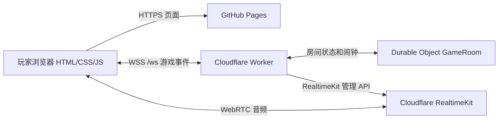

> **最新更新 V7.7.3（2026-11-07）**：质疑后不再出现翻牌画廊，直接在纸箱桌面先翻上一手判定真假、再摊开其他所有牌；大牌堆可在桌面左右翻页，所有牌面均独立清楚显示。A 只标为 A。详见 `CHANGELOG.md`。

> **V7.7.1 最新补丁：** 所有玩家离线超过 2 小时自动关闭旧房间；下次访问默认主菜单。短时间掉线仍可恢复；在线房间保持不变。

<div align="center">

# 🃏 吹牛逼 | 宿舍纸箱牌桌 · 真人联机

**1–6 人可开桌，按人数自动发牌。敢出，就别怕被掀牌。**

一个以中国大学宿舍为场景的免费好友联机吹牛扑克小游戏：创建房间、盖牌宣称、当场质疑、翻牌验真，也可以开麦边玩边聊。

**当前网页版本：V7.7.3 · 牌桌直接翻牌、A 只显示 A** ｜ **玩家人数：1–6 人** ｜ **平台：电脑 / 手机 / 平板**

[🎮 立即进入游戏](https://kilemoran.github.io/chuiniubi/) · [📦 项目源码](https://github.com/KileMoran/chuiniubi) · [🩺 联机服务器状态](https://my-chuiniubi-room.syc050609.workers.dev/health)

**制作与维护：KyleMoran**  
*GitHub 仓库账号为 `KileMoran`，与游戏内作者署名 `KyleMoran` 的拼写不同，以现有仓库链接为准。*

</div>

> [!NOTE]
> 本项目主要面向朋友之间的非商业娱乐。它不是标准化的商业游戏平台，也没有账号登录、排行榜、支付或完整的社区管理体系。游戏房间与语音依赖第三方云服务，实际可用性和费用以服务提供方当前状态为准。

---

## 📚 目录

- [01 · 项目介绍](#01--项目介绍)
- [02 · 游戏特色](#02--游戏特色)
- [03 · 30 秒快速开始](#03--30-秒快速开始)
- [04 · 完整玩法与胜负规则](#04--完整玩法与胜负规则)
- [05 · 页面与操作说明](#05--页面与操作说明)
- [06 · 手机横竖屏适配](#06--手机横竖屏适配)
- [07 · 实时语音聊天](#07--实时语音聊天)
- [08 · 断线重连与房间恢复](#08--断线重连与房间恢复)
- [09 · 系统架构与数据流](#09--系统架构与数据流)
- [10 · 项目文件结构](#10--项目文件结构)
- [11 · GitHub Pages 与 Cloudflare 部署教程](#11--github-pages-与-cloudflare-部署教程)
- [12 · RealtimeKit 语音配置教程](#12--realtimekit-语音配置教程)
- [13 · 运行接口与技术细节](#13--运行接口与技术细节)
- [14 · 安全、昵称、隐私与使用边界](#14--安全昵称隐私与使用边界)
- [15 · 中国大陆与海外跨境联机](#15--中国大陆与海外跨境联机)
- [16 · 常见问题与排查](#16--常见问题与排查)
- [17 · 版本更新日志：V1–V7.7](#17--版本更新日志v1v77)
- [18 · 开发与后续计划](#18--开发与后续计划)
- [19 · 作者、贡献与许可说明](#19--作者贡献与许可说明)
- [20 · 参考文档](#20--参考文档)

---

## 01 · 项目介绍

《吹牛逼》是一款基于浏览器的多人“吹牛 / 骗牌 / 质疑”扑克牌游戏。玩家将手牌**背面朝上**放到纸箱牌桌上，并宣称它们属于某个点数；其他玩家可以相信，也可以大喊“假的！！！”并翻开牌验证。

它由早期单机规则原型逐步发展而来，经历了宿舍实景化、卡牌动画、复杂手牌交互、真人在线房间、手机布局、断线重连以及好友语音系统的多轮迭代。现在的页面采用暗色与金色视觉风格，游戏背景是一张被摆在大学宿舍里的大纸箱桌。

### 基本信息

| 项目 | 内容 |
| --- | --- |
| 项目名称 | 吹牛逼（Chuiniubi） |
| 类型 | 多人心理博弈 / 吹牛扑克 / 浏览器小游戏 |
| 当前用户界面版本 | V7.7.3 |
| 当前 Worker 健康检查版本 | `1.1-voice`（独立于网页版本） |
| `package.json` 版本 | `1.0.0`（工具包版本，不是网页迭代号） |
| 玩家数量 | 1–6 人；1 人为单人练习模式 |
| 游戏牌组 | 1–2 人：52 张；3 人：208 张；4–6 人：104 张；**无大小王** |
| 操作设备 | 支持桌面浏览器、手机和平板；触屏可用 |
| 游戏前端 | 单文件 `index.html`，HTML / CSS / JavaScript |
| 游戏后端 | Cloudflare Workers + Durable Objects |
| 游戏同步 | WebSocket |
| 实时语音 | Cloudflare RealtimeKit（WebRTC） |
| 网页托管 | GitHub Pages |
| 作者署名 | **KyleMoran** |
| 项目仓库 | [`KileMoran/chuiniubi`](https://github.com/KileMoran/chuiniubi) |
| 游戏地址 | <https://kilemoran.github.io/chuiniubi/> |

### 项目目标

- **像坐在同一间宿舍里一样玩牌**：有真实桌面、座位、出牌提示、掀牌和收牌动画。
- **不要求玩家安装客户端**：通过网址和六位房间号即可开始。
- **规则由服务器统一判断**：每个玩家仅能看到自己的手牌，无法单纯通过修改前端骗过规则。
- **与朋友聊天更自然**：语音可自愿加入，游戏与语音分离。
- **多设备兼容**：桌面、手机竖屏、手机横屏有不同布局。

## 02 · 游戏特色

| 功能 | 具体表现 |
| --- | --- |
| 🎲 随机起手 | 游戏开始后以简短动画随机选择第一位出牌者 |
| 🃏 按人数配牌 | 1–2 人 1 副、3 人 4 副、4–6 人 2 副，尽量均匀发放 |
| 🎯 新回合手动宣称 | 每轮首手必须点击点数（3～10、J、Q、K、A、2），选牌后才能出牌 |
| 🧍 单人练习 | 单人出牌后自动弃置本手牌并开启新回合，不需要 AI 对手 |
| 🤥 虚报点数 | 实际出的牌可以与宣称点数不同，其他人看不到盖牌内容 |
| 📢 质疑机制 | 对上一手牌提出质疑，揭开这一手、判定真假 |
| ✨ 出牌演出 | 纸箱桌面上的盖牌动画、逐张翻牌、假牌红色提示、收牌效果 |
| 🧠 精确选牌 | 手牌按点数排序，单排重叠显示，可滑动、提前选牌、取消选中 |
| 👥 真人联机 | 六位房间号、邀请链接、房主开局、多人实时同步 |
| 🔁 自动恢复 | 断线自动尝试重连；刷新网页后使用本地凭证恢复身份 |
| 📱 移动端布局 | 竖屏上下布局；横屏左牌桌、右操作区 |
| 🎙️ 好友语音 | 自愿加入、麦克风开关、扬声器静音、好友独立音量、说话反馈 |
| 🏠 游戏首页 | 昵称、创建/加入房间、最近房间恢复、版本信息、作者、更新日志 |
| ✨ 动态视觉 | 首页淡入、金色流光与按钮高亮；支持减少动态效果的系统偏好 |

> [!IMPORTANT]
> **目前不内置 AI 对手。** 可选 1 人练习模式；2–6 人为真人对战，必须等所选人数全部在线，房主才能开局。

## 03 · 30 秒快速开始

### 如果你是房主

1. 打开 [游戏网页](https://kilemoran.github.io/chuiniubi/)。
2. 在首页输入自己的**游戏昵称**（最多 12 个字符）。
3. 选择房间总人数：**1 / 2 / 3 / 4 / 5 / 6 人**。
4. 点击 **「创建新房间」**。
5. 将界面上的**六位房间号**或**邀请链接**发给朋友。
6. 等所有玩家进入并处于在线状态，点击 **「全部到齐 · 开始抽签」**。
7. 系统洗牌、发牌、随机选出先手玩家，然后开始对局。

### 如果你是被邀请的玩家

1. 打开相同网址，输入自己的昵称。
2. 在首页的**加入房间**区域输入六位房间号，点击 **「加入房间」**。
3. 如果朋友直接发送了邀请链接，打开后一般会自动填入房间号。
4. 等房主开局；进入牌局后就能根据回合顺序操作。

### 首次建议

- 房主和玩家**最好各自使用一台设备或独立浏览器环境**，避免相同玩家身份互相顶替连接。
- 先用 4 人房间做一次测试，再邀请更多朋友。
- 初次使用语音时，记得浏览器需要授权麦克风；不加入语音也可以正常玩牌。
- 不要在公开群组传播长期使用的房间邀请码，尤其在没有额外的成员审查功能时。

## 04 · 完整玩法与胜负规则

### 4.1 牌组与牌点顺序

每副标准扑克牌为 **52 张**，包含 13 种点数和 4 种花色，没有 Joker/大小王。**1–2 人用 1 副（52 张），3 人用 4 副（208 张），4–6 人沿用 2 副（104 张）。**

当前界面的手牌排序遵循：

`2 > A > K > Q > J > 10 > 9 > 8 > 7 > 6 > 5 > 4 > 3`

这个排列方便查看与选牌；**本游戏不是“比大小压牌”**。决定某次盖牌是否属实的关键，是实际牌点是否等于当轮宣称的点数。

### 4.2 发牌与先手

- 服务器洗牌后依次发给玩家，尽量均匀分配。
- 所选牌组可能不能被人数整除，因此部分玩家可能多拿一张，这是正常现象。
- 开局随机选择先手玩家，并播放简短抽签动画。
- 每个玩家只能查看自己的完整手牌；其他玩家的手牌只显示数量。

### 4.3 出牌与“宣称”

- 轮到你时，选择 **1–8 张**牌，点击 **「出牌」**。
- 每张实际扑克牌按背面朝上形式进入公共牌堆，其他玩家不知道真假。
- **每轮第一位出牌者**必须在弹出的点数面板手动选择牌面（3～10、J、Q、K、A、2）。未选择前，出牌按钮保持禁用；选完可在提交出牌前修改。
- 质疑结束或全员不出后开始新回合时，点数选择被清空，必须重新手动选择；不能沿用上一轮点数。
- 1 人练习模式下，没有对手质疑或跟牌，每次出牌后会自动弃置本手并开始新回合。
- 本轮后续玩家继续出牌时，**也必须宣称 7**，即使实际打出的牌并不是 7。
- 因为允许虚报，同一轮累计宣称的牌数超过真实牌组中该点数的数量，也**不自动判假**；须由玩家质疑具体的上一手牌。
- 每出一次牌，服务器会进入短暂的操作间隔；目前为约 **2 秒**。

### 4.4 质疑上一手牌

其他玩家可以针对**最后一次出牌**点击 **「掀牌质疑」**：

1. 发起质疑后，质疑者出现“假的！！！”提示。
2. 系统翻开**最后一次出牌的真实牌面**来判断是否撒谎；同时桌面会展示本轮牌堆的翻牌视觉效果。
3. 如果最后一手中**至少有一张牌的点数**与宣称点数不一致，质疑成功：**出假牌的玩家收走本轮桌面全部牌**。
4. 如果最后一手**全部符合宣称点数**，质疑失败：**发起质疑的玩家收走本轮桌面全部牌**。
5. 假牌在翻牌演出中有红色提示，随后展示收牌动画。

**注意：** 规则判断的是*最后一手*是否真实，不是把本轮每一位玩家之前的出牌都合并判定。约 2 秒的间隔过后，若尚未产生新的出牌，按服务端当前阶段规则仍可能质疑最后一手；新的出牌发生后，可质疑目标变成新的最后一手。

### 4.5 不出牌与弃牌

- 在不是本轮首手的情况下，轮到你可以选择 **「不出牌」**。
- 若其他所有玩家都连续选择不出牌，服务器将把本轮桌面牌**背面弃置**，不揭开它们的真实牌面。
- 弃牌被放入弃牌区，不计入任何玩家手牌。
- 由本轮最后出过牌的玩家开启下一轮；下一轮可以重新宣称点数。

### 4.6 胜利条件

目标是：**尽快出完自己手上的牌**。

当玩家最后一次出牌使手牌归零后，仍需要经过该手牌的质疑机会：如果无人成功挑战，或按规则确认该玩家获胜，游戏结束。胜负由服务器统一处理，前端不能自行宣布自己获胜。

### 4.7 操作按钮与视觉含义

| 按钮/区域 | 作用 |
| --- | --- |
| **宣称** | 首手选择本轮需要宣称的点数；本轮点数固定后不可随意更改 |
| **出牌** | 打出当前选中的 1–8 张手牌 |
| **掀牌质疑** | 对最新一手牌提出真假挑战 |
| **不出牌** | 放弃自己当前的跟牌回合；首手不可不出牌 |
| **取消选择** | 清除已选择的手牌，不会向服务器出牌 |
| **手牌滑动箭头** | 左右移动手牌视图，访问被遮住的卡牌 |
| **已选牌预览** | 检查当前选中了哪些牌，部分界面可点击取消 |
| **弃牌区** | 查看已经被弃置的牌数，不显示牌面 |
| **房间** | 打开成员与邀请信息 |
| **返回大厅** | 返回主页；注意对局中不能简单地释放座位，仍应使用重连恢复身份 |

## 05 · 页面与操作说明

### 5.1 游戏主页

当前 V7.7 主页是左右分区的金色视觉设计：

- **左侧**：大型游戏标题、标语、玩家昵称、项目与版本信息。
- **右上**：创建房间区域；可设定 4/5/6 人并创建新局。
- **右下**：加入房间区域；可填写六位房间号。
- **其他入口**：恢复上次房间（仅在保存了有效本地凭证时显示）、更新日志、作者 GitHub 链接、可折叠的高级服务器设置。

电脑与平板显示双栏；窄屏会重新排版，避免输入框和按钮重叠。装饰动画只影响视觉表现，不参与游戏胜负。

### 5.2 游戏房间大厅

- 显示房间号和当前人数。
- 房主可以复制邀请链接，等全部玩家进入后开局。
- 语音可以在等待大厅中单独加入。
- 只有房主可以触发开局；房间没满或有玩家掉线时不能开局。

### 5.3 实际牌桌

写实宿舍场景的中央是一张纸箱牌桌，上面显示本轮玩家的暗牌、揭牌、真假标记与收牌过程；桌边显示玩家头像、昵称与剩余手牌张数。

屏幕下方为自己的手牌与行动区：卡牌重叠但可逐张选取；选中的牌会上浮或标记；可以在别人行动时预先选择自己的牌，减少轮到自己时的操作时间。

## 06 · 手机横竖屏适配

| 使用场景 | 设计方式 | 使用建议 |
| --- | --- | --- |
| **手机竖屏** | 上方牌桌、下方手牌和按钮；自己座位信息可做精简以避免重复 | 适合单手查看、切牌与基本操作 |
| **手机横屏** | **左侧约 58% 牌桌，右侧约 42% 操作面板** | 适合完整游玩、看牌桌与出牌操作 |
| **电脑 / 平板宽屏** | 完整宿舍场景、底部大手牌区、右下语音控制 | 推荐桌面操作与多人观战体验 |

手机横屏需要用户自行旋转设备。**网页不能保证在所有 iOS/Android 浏览器中强制旋转屏幕**：如果无法横屏，请关闭设备的竖屏方向锁定，再重新旋转。

### 触屏操作建议

1. 选牌请点击牌面**显示的数字/花色附近**，选中后确认高亮/上浮效果。
2. 当手牌很多时，左右滑动或使用两侧箭头寻找更多牌。
3. 质疑按钮不是随时可用，必须满足服务端阶段条件。
4. 如果 Safari 的地址栏影响视野，可以尝试系统自带的全屏/添加到主屏幕方式；不同版本支持程度可能不同。

## 07 · 实时语音聊天

语音与游戏**分别建立连接**：游戏消息使用 WebSocket；麦克风声音由 Cloudflare RealtimeKit（WebRTC）处理，**不把实时音频片段当作普通游戏动作写进游戏 WebSocket**。

### 玩家可用功能

- **加入语音**：仅对当前游戏房间有效；自愿点击后才请求语音连接。
- **开启 / 关闭麦克风**：加入语音后仍需主动开启麦克风，默认不擅自开麦。
- **扬声器控制**：可以停止听取其他玩家的声音。
- **好友音量**：可在精简面板中针对不同朋友独立调节。
- **说话状态**：对应座位提供语音/说话反馈。
- **退出语音**：不需要退出游戏房间。
- **语音失败不影响游戏**：无法加入 RealtimeKit 时，出牌等核心操作仍可以继续。

### 语音使用步骤

1. 进入游戏房间或等待大厅。
2. 点击 **「加入语音」**。
3. 等待语音连接建立；出现浏览器麦克风权限时，按个人意愿授权。
4. 点击 **「开启麦克风」** 才开始发送自己的音频。
5. 其他玩家可以调整你的音量；你也能对每一位好友设置独立音量。
6. 使用完毕点击 **「退出语音」**。

> [!CAUTION]
> **本项目没有内置“录音保存”“语音转文字”功能，也不应据此推断音频在传输或第三方服务中完全没有日志或处理。** 实时语音依赖浏览器、Cloudflare 和参与者设备；不要分享敏感个人信息。当前语音支持来自功能集成，实际稳定性需要不同网络环境下的真人验证。

### 浏览器声音问题

某些手机浏览器禁止脚本在未发生用户操作时自动播放声音。如果语音已连接但听不到朋友，可检查系统媒体音量、网页静音状态，并按游戏提示点击 **「点击播放声音」**。

## 08 · 断线重连与房间恢复

游戏没有注册账号或密码。当前版本靠每个浏览器本地保存的**房间号、昵称和随机玩家凭证**来识别同一位玩家。

### 典型情形

| 情形 | 预期行为 / 限制 |
| --- | --- |
| 网络短时断开 | 客户端自动尝试重新建立 WebSocket |
| 关闭/刷新网页 | 只要本地凭证存在且服务器房间仍可恢复，网页会尝试回原座位 |
| 同设备进入原房间 | 可以通过“恢复上次房间”手动重试 |
| 使用无痕模式 | 浏览器关闭后凭证可能消失，不保证能恢复 |
| 清除网站数据 | 本地凭证会丢失，不能仅凭昵称证明原身份 |
| 换电脑/换手机 | 默认不能自动继承原座位，需要另外的账号迁移机制 |
| 同一身份同时开两个页面 | 新连接可能顶替旧连接，不建议同一身份多标签页操作 |
| 正在进行中的玩家点“退出房间” | 服务端不支持直接删除对局中的座位；应关闭页面并用原身份重连 |

> [!IMPORTANT]
> **不要为了修复断线而随意清除浏览器缓存/网站数据**。这可能删除恢复原座位需要的凭证。网页版无法保证在所有断网、休眠、服务器故障或浏览器清理情形下恢复。

## 09 · 系统架构与数据流

### 9.1 三层架构



- **GitHub Pages** 只负责托管静态网页，不是实时游戏服务器。
- **Cloudflare Worker** 负责 WebSocket 升级、健康检查与请求路由。
- **Durable Object (`GameRoom`)** 让同一房间的玩家共享权威的游戏状态，负责发牌、验证出牌与质疑、阶段计时、同步状态、恢复。
- **RealtimeKit** 按游戏房间建立独立的语音会议，通过后端授权返回给玩家单独的加入凭证。

### 9.2 为什么不能只靠 GitHub Pages 直接联机？

GitHub Pages 托管静态内容，不能持续保存并同步多名玩家的即时房间状态；本项目由 Cloudflare Worker / Durable Object 充当游戏服务器。**仅上传 `index.html` 到 GitHub，不会自动拥有可用的多人服务器。**

### 9.3 为什么作弊不应只交给前端判断？

- 实际牌堆、所有玩家原始手牌与游戏阶段保存在服务器。
- 浏览器收到的是每位玩家能看到的**公开状态**和**自己的手牌**。
- 服务端验证房主权限、所选卡牌是否属于自己、每次出牌数量、点数宣称、行动阶段与胜负。
- 质疑后的真假和收牌对象由服务器计算。

这提供了基础防作弊保障，但**不等于经过完整的渗透测试或具备商业级防恶意攻击能力**。

## 10 · 项目文件结构

```text
chuiniubi/
├── index.html           # 完整游戏网页：视觉、交互、联机客户端、语音 UI
├── README.md            # 你正在阅读的项目文档
├── package.json         # Node/Wrangler 开发与部署脚本
├── wrangler.toml        # Worker、Durable Object、保留变量配置
└── server/
    ├── worker.js        # /health、/ws、GameRoom 与语音令牌管理
    └── game.js          # 服务端规则、洗牌、回合、质疑与公开状态
```

**注意：** `index.html` 集成了游戏场景和部分资源，不代表所有依赖都能离线运行：语音 SDK 在玩家加入语音时仍会从外部 CDN 加载。`package.json` 提供了测试脚本，但如果仓库没有同时上传 `tests/` 目录，本地执行 `npm test` 可能因为找不到测试文件而失败。

## 11 · GitHub Pages 与 Cloudflare 部署教程

下面是本项目当前使用的**浏览器网页部署方案**。正常上传与配置不需要在自己的电脑安装 Node.js。

### 11.1 创建 GitHub 仓库

1. 登录 [GitHub](https://github.com/new)。
2. 建立一个公开仓库，例如 `chuiniubi`。
3. 将项目文件上传到仓库根目录，尤其确保 `index.html` 与 `server/` 文件夹存在。
4. 提交到 `main` 分支。
5. 不要把 `.zip` 当成网页源码上传并期待 GitHub 自动解压；应上传解压后的文件。

### 11.2 启用 GitHub Pages

1. 打开仓库 **Settings → Pages**。
2. Source 选择 **Deploy from a branch**。
3. Branch 选择 `main`，文件夹选择 `/(root)`。
4. 保存后，GitHub Pages 会从根目录的 `index.html` 发布网页。
5. 查看仓库 Pages 页面给出的实际网址。

如果仓库仍是 `KileMoran/chuiniubi`，网址为：

```text
https://kilemoran.github.io/chuiniubi/
```

### 11.3 创建 Cloudflare Worker

1. 登录 [Cloudflare Dashboard](https://dash.cloudflare.com/)。
2. 进入 **Workers & Pages → Create application → GitHub / Import repository**。
3. 选择仓库 `KileMoran/chuiniubi`（如果你 Fork 了，则选你的 Fork）。
4. 设置 Worker 项目名称与 `wrangler.toml` 中 `name` 一致，如 `my-chuiniubi-room`。
5. 使用仓库根目录作为 Root directory (`/`)。
6. Build command 保持留空；Deploy command 填写 `npx wrangler deploy`。
7. 部署成功后，在 Worker 的 **Settings → Bindings** 确认 `ROOMS` Durable Object 绑定存在。

仓库中的主要配置如下：

```toml
keep_vars = true
name = "my-chuiniubi-room"
main = "server/worker.js"
compatibility_date = "2026-11-07"

[[durable_objects.bindings]]
name = "ROOMS"
class_name = "GameRoom"

[[migrations]]
tag = "v1"
new_sqlite_classes = ["GameRoom"]
```

`keep_vars = true` 是为了在通过 Wrangler/自动构建发布新代码时保留已经在 Cloudflare 控制台配置的运行时变量。它不能代替把 Secret 正确保存到运行时配置里。

> [!WARNING]
> 若你将项目部署到**自己的** Cloudflare 账户，Worker URL 不一定与作者的默认 URL 相同；需要在网页“高级设置”中填写你的 WebSocket 地址，或在 `index.html` 里修改 `DEFAULT_SERVER`。不要错误地让自己的游戏网页默认连接到作者正在运行的公共房间服务器。

### 11.4 检查联机 Worker

浏览器打开：

```text
https://my-chuiniubi-room.syc050609.workers.dev/health
```

正常健康检查示例：

```json
{
  "ok": true,
  "service": "吹牛逼·联机服务器",
  "version": "1.1-voice"
}
```

健康检查通过只代表 HTTP 接口能响应，**不代表 WebSocket 和语音已经经过完整多人验证**。

### 11.5 自动更新流程

- **只修改网页 UI / CSS / 首页**：提交根目录 `index.html`；GitHub Pages 更新即可。
- **修改游戏规则 / 语音服务端接口**：提交 `server/game.js` 或 `server/worker.js`；Cloudflare 需要完成新的 Worker 部署。
- **修改 Worker 配置**：提交 `wrangler.toml`；留意 Durable Object 迁移和运行时变量配置，不要随意改现有迁移标签或类名。
- **只改 README**：提交 `README.md`，不需要重新配置语音服务或修改游戏房间。

### 11.6 开发者可选：本地调试

如你有 Node.js 环境，可选择：

```bash
npm install
npm run dev
# 或
npm run deploy
```

**普通朋友游玩不需要以上命令。** 即使本地启动 Worker，也应使用适合当前环境的测试地址与独立的调试房间，避免误连正式对局。

## 12 · RealtimeKit 语音配置教程

### 12.1 新建应用和语音预设

1. 打开 Cloudflare Dashboard，进入左侧 **Realtime → RealtimeKit**。
2. 创建应用，例如 `chuiniubi-voice`。
3. 在应用的 **Presets** 中创建 `voice_game` 预设。
4. Meeting Type 选择 **Voice (WebRTC)**。
5. 在 **Stage & Media** 中勾选 **Audio**；不用视频和屏幕共享。
6. 不需要创建供玩家长期手工加入的 Meeting；服务器会按游戏房间自动创建和复用语音会议。

### 12.2 创建最小权限 API Token

前往 [Cloudflare API Tokens](https://dash.cloudflare.com/profile/api-tokens)：

- 新建自定义 Token，名称示例：`chuiniubi-voice-api`。
- 权限范围尽量限制到你的 Cloudflare 账户。
- 权限选择 Realtime 相关的 **Admin** 权限，避免无关权限。
- **绝对不要**把 Token 粘贴到 GitHub、HTML、README、Issue、聊天截图、浏览器地址栏或客户端 JS 中。

### 12.3 设置 Worker 的运行时变量

重要：这里指的是 **Worker 的 Runtime variables and secrets**，**不是 Builds → Variables and secrets**。

路径一般为：**Workers & Pages → 你的 Worker → Settings → Variables and secrets**。

| 变量名称 | 示例/用途 | 类型 |
| --- | --- | --- |
| `CF_RTK_ACCOUNT_ID` | 当前 Cloudflare 账户 ID | **Variable** |
| `CF_RTK_APP_ID` | 刚创建的 RealtimeKit App ID | **Variable** |
| `CF_RTK_PRESET` | `voice_game`，必须与已有预设名称完全一致 | **Variable** |
| `CF_RTK_API_TOKEN` | 上一步生成的 API Token | **Secret** |

> [!IMPORTANT]
> `CF_RTK_API_TOKEN` 应显示加密保存（如 `Value encrypted`）。另外三个 ID/预设名称虽然不是同等级别的密钥，也不需要在 README 中写真实账户值；不要意外暴露不必要的账户信息。

### 12.4 测试语音

1. 两名玩家使用两台设备，进入同一个游戏房间。
2. 各自点击 **「加入语音」**。
3. 浏览器允许音频权限后，主动点击 **「开启麦克风」**。
4. 让第一人说话、第二人听；然后交换。
5. 检查扬声器开关、好友音量面板、静音与退出语音。
6. 如果两人同处一室测试，请带耳机，避免麦克风回声啸叫。
7. 再测试其中一方刷新页面、恢复游戏房间后重新进入语音。

### 12.5 为什么不把音频写进游戏 Worker？

WebRTC 专为低延迟媒体通信而设计；Worker 保留房间成员身份校验与语音令牌颁发，RealtimeKit 负责实际音频连接。这样游戏状态与语音媒体不会互相阻塞。

## 13 · 运行接口与技术细节

### 13.1 当前服务端 HTTP 路径

| 路径 / 消息 | 用途 | 备注 |
| --- | --- | --- |
| `GET /health` | 返回服务状态和代码版本 | 不涉及游戏玩家身份 |
| `GET /ws?...`（WebSocket Upgrade） | 加入/恢复指定游戏房间 | 需要合法房间号和玩家令牌 |
| WebSocket `start` | 房主开局 | 服务端检查人数与在线状态 |
| WebSocket `play` | 出牌 | 服务端检查卡牌 ID、宣称点数与回合 |
| WebSocket `pass` | 不出牌 | 不允许在本轮首手直接 pass |
| WebSocket `challenge` | 质疑最新一手 | 服务器判断真假与收牌归属 |
| WebSocket `voice_ticket` | 请求当前房间的语音令牌 | 需要已加入对应游戏房间 |
| WebSocket `leave` | 在允许的阶段退出房间 | 进行中的牌局有限制 |

不要对 `GET /ws` 直接用普通浏览器访问并期待显示网页；该接口需要建立 WebSocket 连接。

### 13.2 服务端数据生命周期

- Durable Object 为每个房间维护游戏状态（玩家、手牌、牌堆、阶段与相关语音会议信息）。
- 浏览器使用自己的本地 Token 重连，服务端找到对应座位后发送该玩家可见的状态。
- 关键阶段使用持久化存储和 Alarm 推进，例如质疑演出、揭牌、收牌等。
- **不能据此保证房间数据在某个固定时间自动删除**；当前项目未提供完整的自助数据导出、删除或保留期限管理界面。

### 13.3 测试与排错思路

适合开发时验证的事项：

- 洗牌后总牌数按房间人数守恒：1–2 人 52、3 人 208、4–6 人 104。
- 不允许打出不属于自己的牌或重复选中同一张牌。
- 超过 8 张牌的出牌请求应被拒绝。
- 质疑只检查最新一手，收牌对象符合规则。
- 全员 pass 后按规则弃牌，下一轮重置宣称点数。
- 非房主不能开局，人数未满时不能开局。
- 玩家只能收到自己的私有手牌内容。
- 同一个身份刷新后可以在本地凭证未丢失时恢复。

## 14 · 安全、昵称、隐私与使用边界

### 14.1 昵称有没有敏感词审核？

**当前代码没有独立的敏感词列表、机器审核或 AI 内容过滤系统。** 服务端做的主要是格式清理：移除部分控制字符及尖括号、清除首尾空白、限制昵称长度至最多 12 个字符。

这意味着一些普通人名、公众人物姓名或其他字词不会仅因“出现在某个预设黑名单”而在本项目代码中自动拒绝。但这**不意味着任何昵称都合法、妥当、不会被举报，或绝对不会被上游平台处理**。

建议参与者不要：

- 冒充真实人物、官方机构或游戏管理员进行欺骗；
- 发布威胁、仇恨、骚扰、诽谤或侵权内容；
- 用昵称或语音传播他人的私人资料；
- 因为项目没有内置内容审查就认为可以无视适用法律或云服务使用条款。

GitHub 与 Cloudflare 可能依据自己的平台规则采取措施。若未来向公众开放，应考虑举报、房主踢人、昵称规则和恶意使用防护等功能。

### 14.2 身份与安全边界

- 当前没有正式账号登录或密码；**六位房间号不是强访问控制**。
- 玩家身份凭证存储在浏览器本地；不应共享自己的身份 Token 或开发者控制台信息。
- 房间号与游戏昵称会用于游戏连接；后端可能通过第三方基础设施处理网络元数据。
- 尽量用私密邀请链接和可靠的浏览器设备进行朋友局。
- 前端 HTML 公开可读，**绝不能将 Cloudflare API Secret 写进前端文件**。

### 14.3 数据与隐私

目前项目主要处理昵称、房间身份、游戏动作、手牌和语音会议信息。游戏代码本身没有提供独立的账号注册系统、广告画像或站内语音录制功能，但云服务提供方可能根据各自政策保留必要的安全或运营日志。**不要宣称“完全无记录、绝对匿名、所有数据即时删除”。**

如果要用于陌生人开放社区、未成年人、商业服务或持续公开运营，应先重新评估隐私告知、数据保存期限、投诉处理与当地合规义务。

### 14.4 个人与小型非商业项目

本项目是朋友娱乐作品，现有结构重点是玩法体验与便利部署，而不是为大规模陌生人平台设计的身份验证、安全审计或合规系统。公开传播时请遵守法律、服务商协议及当地网络管理规定。

## 15 · 中国大陆与海外跨境联机

项目页面、游戏同步和语音走的是**三条不同链路**，因此“网页能打开”与“能稳定联机/语音”必须分别判断。

| 链路 | 当前服务 | 可能的问题 | 优先验证 |
| --- | --- | --- | --- |
| 网页静态资源 | `kilemoran.github.io` / GitHub Pages | 不同地区可能加载缓慢、超时或无法打开 | 能否看到首页及背景 |
| 游戏房间 | `my-chuiniubi-room.syc050609.workers.dev` / WebSocket | 跨境延迟、偶发断开、握手失败 | `/health` 能否打开、创建加入房间与出牌是否同步 |
| 实时语音 | Cloudflare RealtimeKit / WebRTC + 外部 SDK CDN | SDK 加载失败、麦克风权限、媒体网络不通、延迟/卡顿 | 进入语音、双向说话是否正常 |

Cloudflare 官方明确指出，面向中国大陆的跨境网络流量可能有更高延迟和更低可靠性；其 Realtime TURN 服务也不会在中国大陆 Cloudflare China Network 内运行。GitHub Pages 的 `github.io` 在不同中国大陆网络环境下也不保证一致可达。**本项目并未承诺中国大陆境内的低延迟或稳定语音服务**。

### 建议让国内朋友按顺序测试

1. **先验证首页**：直接访问游戏网址，看是否能完整显示。
2. **再验证服务器**：单独打开 `https://my-chuiniubi-room.syc050609.workers.dev/health`，确认接口能响应。
3. **再验证 WebSocket**：使用另一台设备创建/加入一个测试房间；留意“在线”状态是否持续。
4. **再验证游戏**：至少玩几轮，观察出牌动画、质疑回应与断线恢复。
5. **最后验证语音**：双方佩戴耳机，测试静音、双向声音和持续稳定性。
6. **交叉网络测试**：可以分别尝试家用宽带、移动数据和不同运营商；记录发生问题的环节。

**特别提醒：** 游戏有约 2 秒的出牌间隔，跨境延迟或连接抖动会影响抢质疑的操作时机。即使网页加载正常，网络延迟也可能改变实际手感。

如果只是朋友之间小规模游玩，优先实测现有部署，不必急于换服务器；如果目标变为长期服务大量中国大陆玩家，再单独评估更稳定的托管位置、合法域名/备案要求和专用网络方案，不应简单推断境外自建页面在中国大陆一定能稳定访问。

## 16 · 常见问题与排查

| 问题 | 可能原因 | 建议处理 |
| --- | --- | --- |
| 首页能打开但无法创建房间 | Worker 地址不正确，WebSocket 被拦截，服务器部署失败 | 先测 `/health`，再检查高级服务器地址、Cloudflare Deployments |
| 显示“房间不存在” | 房间号填错、房间还未创建或状态不可用 | 让房主重新复制当前六位房间号 |
| 有人进不来 | 人数已满、对局已经开始、网络不通 | 确认房间人数与状态；新玩家不能中途占位加入已开的牌局 |
| 房主无法开局 | 人数不足或有玩家掉线 | 等所选人数全员在线，再点击开始 |
| 我刷新后变成新玩家 | 账号无登录机制；本地 Token 丢失或换了设备 | 用最初的浏览器与同一网站地址恢复；不要先清网站数据 |
| 点击返回大厅后占位仍在 | 正在进行中的座位由服务端保存，以支持重连 | 继续游戏时使用“恢复上次房间”；不要同时用新身份占位 |
| 手牌太多看不到最右侧 | 单排重叠手牌需要滚动 | 左右滑动或用导航箭头 |
| “掀牌质疑”按钮灰色 | 当前阶段不允许质疑，或目标是自己刚出的牌 | 等合适的上一手与质疑阶段 |
| 语音按钮显示未配置 | Worker 未设置 RealtimeKit 运行时变量，或未成功重新部署 | 检查四项 `CF_RTK_*`，确认配置在 **Runtime** 而不是 **Builds** |
| 语音加入失败 | 预设名称错误、Token 权限不足、RealtimeKit API 失败 | 检查 `voice_game`、API Token 权限、Worker 日志 |
| 语音连上但听不见 | 麦克风未开启、设备媒体音量为 0、浏览器禁止自动播放 | 开麦、检查系统音量、点击“播放声音”、戴耳机测试 |
| 国内朋友能打开网页但无法语音 | 游戏数据链路与 WebRTC 媒体链路并不相同 | 分别排查 SDK 加载、WebRTC 与网络连通性 |
| 修改网页后还是旧版 | GitHub Pages 未更新或浏览器缓存 | 确认 Commit、GitHub Pages 发布状态并刷新页面 |
| Worker 更新后变量不见了 | 运行时变量和构建变量混淆，或部署配置未保留 | 检查 `keep_vars = true`，在 Runtime variables 中核对配置 |
| 手机横屏仍很挤 | 浏览器 UI 占空间、方向锁定、设备宽高比不同 | 关闭方向锁定，尝试浏览器全屏或调整浏览器显示大小 |

### 反馈问题时，最好提供

- 浏览器与设备型号（例如 Windows Edge / iPad Safari / Android Chrome）。
- 问题是在电脑、竖屏还是横屏发生。
- 能否访问 `/health`；若能，请提供返回的版本号。
- 完整报错文字或**不含 Token、敏感数据**的截图。
- 复现步骤：先点击了什么，随后发生了什么。

## 17 · 版本更新日志：V1–V7.7

> 下面是根据项目开发迭代整理的主要版本节点，**并非 GitHub Releases 官方发布时间线**。早期版本的具体发布日未统一记录，因此不编造日期。当前整理共 **31 个版本节点**。

### V7 · 真人联机、语音与游戏首页（11 个节点）

| 版本 | 主题 | 主要变化 |
| --- | --- | --- |
| **V7.7** | 每轮手动点数与1–3人对局 | 轮首必须手动选择宣称点数，重开回合清除前次选择；新增 1/2/3 人房间与按人数发牌，1 人自动进入下一轮 |
| **V7.6** | 金色动态首页 | 新增版本、作者和更新日志入口；首页淡入过渡、金色流光与互动高亮；后续扩充完整历史日志，作者显示为 **KyleMoran** |
| **V7.5** | 正式游戏首页设计 | 重做首页视觉；左侧昵称与游戏介绍，右侧创建/加入房间；适配桌面及手机 |
| **V7.4.3** | 首页布局重构 | 传统单列入口改成左右区域；保留恢复上次房间 |
| **V7.4.2** | 质疑结果提示精简 | 移除中央重复的真假结果框和收牌说明，保留上方提示和揭牌动画 |
| **V7.4.1** | 好友音量面板修复 | 修复“好友音量设置”被拉成横跨屏幕长条的问题，改为紧凑面板 |
| **V7.4** | 实时语音与手机横屏 | 接入 RealtimeKit，添加加入语音/静音/独立音量/说话状态；横屏左牌桌右操作 |
| **V7.3** | 手机画面适配 | 竖屏牌桌、玩家位置、底部手牌和按钮重新布局；改进横屏适配 |
| **V7.2** | 断线恢复 | 保存房间与身份凭证；刷新后自动恢复、手动重连，减少断线弹窗干扰 |
| **V7.1** | 浏览器部署包 | 适配 GitHub 上传与 Cloudflare Git 集成自动部署，提供配置文件与部署说明 |
| **V7.0** | 真人联网版 | 移除 AI 玩家；支持 4–6 人房间、六位房间号、服务端规则校验、实时同步 |

### V6 · 手牌与交互打磨（4 个节点）

| 版本 | 主题 | 主要变化 |
| --- | --- | --- |
| **V6.3** | 操作按钮与规则修复 | 优化操作按钮位置，修复全员连续不出牌时的弃牌流程等问题 |
| **V6.2** | 底部操作栏居中 | 调整出牌操作栏的位置，避免被底部手牌遮挡 |
| **V6.1** | 精准选牌 | 改进重叠手牌的触控命中区域；其他玩家行动时保留已选手牌 |
| **V6.0** | 单排滑动手牌 | 手牌智能重叠、可左右滑动，可预览已选牌，大手牌量仍可操作 |

### V5 · 宿舍牌桌细节（10 个节点）

| 版本 | 主题 | 主要变化 |
| --- | --- | --- |
| **V5.9** | 手牌降序排列 | 左到右按 2、A、K、Q、J、10 到 3 排列 |
| **V5.8** | 开局随机先手 | 增加随机出牌玩家的抽签过程和结果展示 |
| **V5.7** | 当前宣称点数 | 牌桌明确显示本轮必须宣称的点数 |
| **V5.6** | 自己的座位优化 | 调整左下角自身头像、名称、手牌位置 |
| **V5.5** | 提示去重 | 清除顶部重复的最新宣称信息 |
| **V5.4** | 简明出牌提示 | 将操作提示简化为类似“玩家 A 出了 3 张 7”的单行文字 |
| **V5.3** | 出牌反馈 | 优化其他玩家出牌的文字反馈与可视提示 |
| **V5.2** | 质疑喊话 | 增加“假的！！！”气泡、质疑翻牌与假牌视觉标记 |
| **V5.1** | 玩家头像与行动状态 | 扩大头像及名称、高亮当前行动者 |
| **V5** | 纸箱牌桌强化 | 调整桌面比例，使纸箱在宿舍场景里更突出 |

### V1–V4 · 从基础原型到宿舍实景（6 个节点）

| 版本 | 主题 | 主要变化 |
| --- | --- | --- |
| **V4.1** | 纸箱聚焦版 | 聚焦纸箱出牌区域，调整镜头和桌面占比 |
| **V4** | 写实宿舍场景 | 引入更真实的床铺、书桌与纸箱环境 |
| **V3** | 宿舍主题牌桌 | 宿舍风格多人座位和完整视觉布局 |
| **V2.1** | 盖牌与掀牌分区 | 改进盖牌、掀牌的桌面区域和质疑反馈 |
| **V2** | 浏览器牌桌雏形 | 将核心玩法移植为可交互网页，增加出牌落桌表现 |
| **V1** | 核心规则原型 | 双副扑克牌、虚报、质疑、收牌、胜利条件等基础机制 |

## 18 · 开发与后续计划

当前项目支持 1–6 人进行练习或好友联机游戏。以下均为**可考虑的后续方向，不代表已经实现**：

- [ ] 房主踢人、恶意昵称拦截与举报工具。
- [ ] 更清晰的长期房间清理机制与隐私说明。
- [ ] 更强的玩家身份验证和跨设备恢复。
- [ ] 带多地区可用性检测的网络诊断页。
- [ ] 中国大陆与英国之间的长时间游戏和语音质量测试。
- [ ] 更多音频体验改进（按键说话、设备选择、回声处理）。
- [ ] 游戏操作指引、首次新手教学与便捷规则说明。
- [ ] 自动化 UI / 多浏览器回归测试和更完整的错误日志。
- [ ] 房间密码、陌生人限制与长期公开运营所需的安全能力。

提交新功能前，请优先确保**现有的服务器规则、按人数计算的牌数守恒、语音 Token 不泄露以及手机横屏的操作区**不被破坏。

## 19 · 作者、贡献与许可说明

### 作者与项目链接

- **制作 / 维护：KyleMoran**
- **GitHub 账户与仓库：** [`KileMoran/chuiniubi`](https://github.com/KileMoran/chuiniubi)
- **游戏网页：** <https://kilemoran.github.io/chuiniubi/>

欢迎通过仓库的 [Issues](https://github.com/KileMoran/chuiniubi/issues) 反馈问题；提交时请提供可复现步骤，不要上传 API Token、私人房间身份令牌或无关个人信息。

### 源码与素材授权

**本 README 不擅自替仓库声明任何开源许可证。** 如果仓库尚未发布 `LICENSE` 文件，公开可见的源码并不自动意味着第三方获得了任意复制、商用或再分发的授权。发布者还应确认游戏所用背景图片、角色头像、字体及其他素材具有合适的使用权限；第三方服务也遵守其各自许可证和使用条款。

如果以后明确选择 MIT / Apache-2.0 等许可证，应由仓库维护者核对所有素材权利后正式添加 `LICENSE` 文件，而不是仅在 README 中口头写上“完全开源”。

### 独立项目说明

本作品是独立的朋友娱乐网页项目，与 GitHub、Cloudflare 或任何校园机构不存在官方附属或背书关系。涉及的品牌、平台与 API 名称仅用于说明技术集成。

## 20 · 参考文档

以下是相关官方文档和网络可访问性参考，访问情况、价格和产品接口可能随时间变化：

- [GitHub Pages 文档](https://docs.github.com/en/pages)
- [GitHub 可接受使用政策](https://docs.github.com/en/site-policy/acceptable-use-policies/github-acceptable-use-policies)
- [Cloudflare Workers 文档](https://developers.cloudflare.com/workers/)
- [Cloudflare Workers · Routes and domains](https://developers.cloudflare.com/workers/configuration/routing/)
- [Cloudflare Durable Objects 文档](https://developers.cloudflare.com/durable-objects/)
- [Cloudflare RealtimeKit 文档](https://developers.cloudflare.com/realtime/realtimekit/)
- [Cloudflare RealtimeKit · 网络允许列表](https://developers.cloudflare.com/realtime/realtimekit/platform/network-allowlist/)
- [Cloudflare Realtime TURN FAQ](https://developers.cloudflare.com/realtime/turn/faq/)
- [Cloudflare 跨区域网络路由说明](https://developers.cloudflare.com/support/troubleshooting/general-troubleshooting/geographic-traffic-routing/)
- [GreatFire · `github.io` 在中国大陆的可访问性数据](https://en.greatfire.org/domain/github.io)（第三方检测，因站点、运营商和时间而异）

---

<div align="center">

### ♠ 叫得越真，不一定越真。♥

**有胆你就出，怀疑你就掀。**

[进入游戏](https://kilemoran.github.io/chuiniubi/) · [返回项目仓库](https://github.com/KileMoran/chuiniubi)

**© 2026 KyleMoran · 吹牛逼**

</div>
